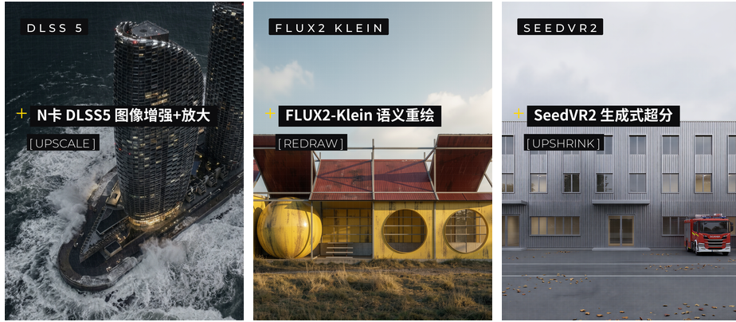
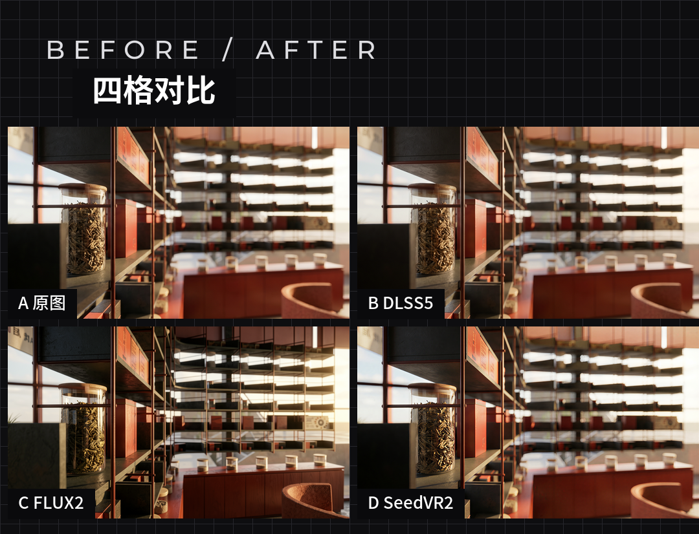

# 图像真实感增强及放大 · Archviz Render Enhancer

> ComfyUI 技能包：建筑与室内效果图的 AI 增强三管线 —— **FLUX2-Klein 语义重绘**、**N卡 DLSS5 图像增强+放大**、**SeedVR2 生成式超分**。
> 3 个 API 工作流 + 4 个脚本 + 环境/排障文档，支持局域网多机分布式调度。



## 为什么做这个

效果图交付前最常见的两件事：**放大后发糊**、**材质像塑料**。市面上的方案要么只能锐化（保真但没质感），要么只能重绘（好看但动画面）。这个技能把两件事拆成三条边界清楚的管线，让"客户允不允许你动画面"变成选型问题：

| 管线 | 做什么 | 画面是否改变 | 实测耗时（热缓存） | 典型用途 |
|---|---|---|---|---|
| **A · FLUX2-Klein 语义重绘** | 参考潜空间锚定结构后重绘整张图 | 会改画面（光影/材质/氛围） | 约 5 秒 / 张 | 换白天与黄昏、换材质倾向、换氛围 |
| **B · N卡 DLSS5 图像增强+放大** | NVIDIA 神经渲染做离线增强与放大 | **零漂移**（构图与光照一像素不动） | 约 20-50 秒 / 张 | 客户要求"不许改画"，或实景照片转效果图质感 |
| **C · SeedVR2 生成式超分** | 扩散式超分 + 1x 细节重建 | 会重绘细节（小物件/人物姿态） | 约 30-90 秒 / 张 | 大图放大、锐度优先、有纵深虚化的场景 |

三条可串联：**重绘定氛围 → 补材质 → 收细节**。



*同一张图，四种结果并排：原图 / DLSS5 增强 / FLUX2 重绘 / SeedVR2 超分。*

## 快速开始

```bash
# 1) 环境自检（GPU / 驱动 / torch / 节点 / 模型一次查清）
python scripts/check_env.py --host 127.0.0.1 --port 8188

# 2) 跑一条管线（换 --workflow 即可切换 A/B/C）
python scripts/queue_workflow.py --host 127.0.0.1 --port 8188 \
  --workflow workflows/pipeline_b_dlss5_enhance.json \
  --input "C:/path/render.png" --save-dir ./out

# 3) 出对比图（--crop 做中心细节裁切）
python scripts/make_comparison.py --out compare.png \
  --image "A 原图=orig.png" --image "B DLSS5=out/dlss5.png" --crop 480,320
```

`queue_workflow.py` 会自动完成：上传图片到目标 ComfyUI 的 `input/` → 替换工作流里的 `LoadImage` 文件名 → `POST /prompt` → 轮询 `/history` → 把产物下载到 `--save-dir`。

## 环境要求

| 项目 | 要求 | 说明 |
|---|---|---|
| 显卡 | NVIDIA RTX 30/40/50 系 | DLSS5 离线运行时需 RTX；实测 4080 16GB / 5070 12GB |
| 驱动 | 580+ | 实测 610.88，自报 CUDA UMD 13.3 |
| **PyTorch** | **2.11.0+cu130** | **必须**：cu126 下加载 fp8 模型会直接让进程崩溃（见下方排障） |
| ComfyUI | 0.28+ | 实测 0.38.2，需 `comfy_api` V3 节点 API |
| Python | 3.12 | Windows portable 自带嵌入式环境 |
| 存储 | 模型放 SSD | 机械盘随机读仅 0.98MB/s，会把加载拖到几十分钟 |

**PyTorch 升级（关键一步，免重启电脑，只需重启 ComfyUI 进程）**

```bash
python_embeded\python.exe -m pip install \
  torch==2.11.0+cu130 torchvision==0.26.0+cu130 torchaudio==2.11.0+cu130 \
  --index-url https://download.pytorch.org/whl/cu130
```

版本必须锁 `2.11.0`：torchaudio 在 cu130 上最高只到 2.11.0，torch 2.12+ 会配不到 torchaudio。

## 模型清单

| 文件 | 目录 | 用途 |
|---|---|---|
| `flux-2-klein-9b-fp8.safetensors` / `-4b-` | `diffusion_models/` | 管线 A 主模型（9B 终稿 / 4B 草稿） |
| `qwen_3_8b_fp8mixed.safetensors` / `qwen_3_4b.safetensors` | `text_encoders/` | 管线 A 文本编码器 |
| `flux2-vae.safetensors` | `vae/` | 管线 A |
| `1x-ReFocus-V3.pth` | `upscale_models/` | 管线 C 的 1x 细节重建（[下载](https://huggingface.co/notkenski/upscalers)） |
| `4x-UltraSharp.pth` | `upscale_models/` | 通用 4x 放大 |
| `seedvr2_ema_3b_fp8_e4m3fn` | 首次运行自动下载 | 管线 C 的 DiT（3.4GB） |

低频模型（`t5xxl`、`qwen_2.5_vl_7b`、`klein-base-4b`、`hunyuan_3d`）可留在机械盘，用 `extra_model_paths.yaml` 挂载：

```yaml
cold_models:
  base_path: F:\ComfyUI_models\
  checkpoints: checkpoints
  diffusion_models: diffusion_models
  text_encoders: text_encoders
  vae: vae
  loras: loras
  upscale_models: upscale_models
```

## 局域网分布式

```bash
# 计算节点：python ComfyUI/main.py --listen 0.0.0.0 --port 8188
# 主控机：python scripts/queue_workflow.py --host <局域网IP> --port 8188 \
#           --workflow workflows/pipeline_a_flux2_rewrite.json --input render.png
```

两台机的节点与模型需对齐（否则报 `missing node type`）。**ComfyUI 的 HTTP 接口没有鉴权**，`--listen 0.0.0.0` 等于整个局域网可提交任务并取走产物：只在内网用，不要做公网端口映射，需要收紧时用防火墙限定来源 IP。

## 常见故障

| 现象 | 根因 | 处理 |
|---|---|---|
| 加载 fp8 模型时进程瞬间消失（Windows page error） | cu126 下 comfy_kitchen 走 eager 分发路径崩溃 | 升级到 torch 2.11.0+cu130 |
| 页面一直 Reconnecting | 服务器重启后旧标签页不会自动重连 | 确认服务在跑，F5 刷新 |
| 提示缺失 `1x-ReFocus-V3.pth` | 模型没装 | 从 HuggingFace `notkenski/upscalers` 下载放进 `models/upscale_models/` |
| 模型加载慢到无法忍受 | 模型在机械盘 | 热模型挪到 NVMe，冷模型挂载 |
| DLSS5 报 worker 未在 60 秒内退出 | 运行时收尾偶发超时 | 重跑该次任务即可 |
| 提交返回 400 | 节点输入名/枚举值不对 | 看响应体 `node_errors`：`CFGGuider` 用 `positive`/`negative`；SeedVR2 `device` 必须是 `cuda:0` |

完整排障见 [docs/图像真实感增强与放大_使用手册.md](docs/图像真实感增强与放大_使用手册.md) 第七章。

## 目录结构

```
SKILL.md                      技能定义（Agent 读取入口）
workflows/                    3 个 API 工作流（A / B / C）
scripts/                      4 个脚本（提交 / 对比 / 自检 / 出图）
references/                   环境与安装、管线详解、排障
docs/                         完整使用手册（15 页 PDF 同源 Markdown）
images/                       三管线产物与对比图
```

## 说明与授权

- 本仓库为 **MIT** 许可的 Skill 包；`scripts/`、`workflows/`、`references/` 为原创。
- 管线 B 使用社区封装的 DLSS 5 运行时（MIT），**非 NVIDIA 官方插件**，与 NVIDIA 无官方关联；NVIDIA 官方 DLSS 5 实时路径目前面向 RTX 50 系，离线图像路径由社区运行时覆盖 30/40/50 系。
- 各模型请遵循其自身授权条款（FLUX2-Klein / SeedVR2 / 1x-ReFocus 均有独立许可说明）。
- 文中所有参数、耗时与报错均来自真实跑通的管线，非文档摘抄。

---

<sub>by 有物建筑 MeansGroup · Archviz Enhancement Lab · 2026</sub>
